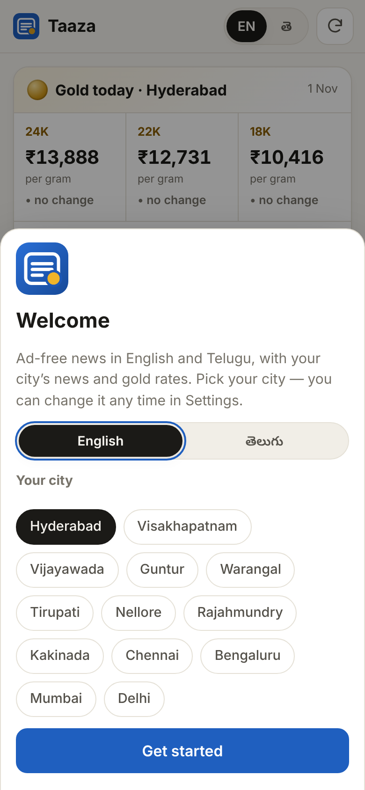
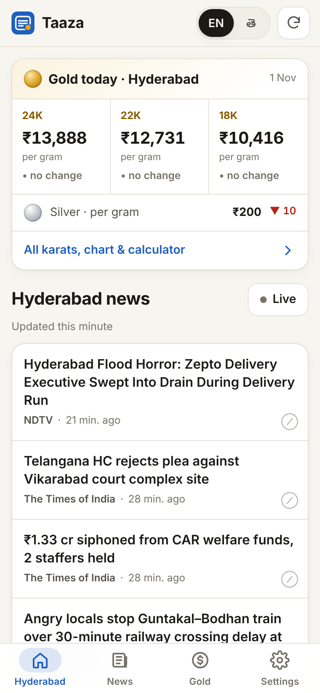
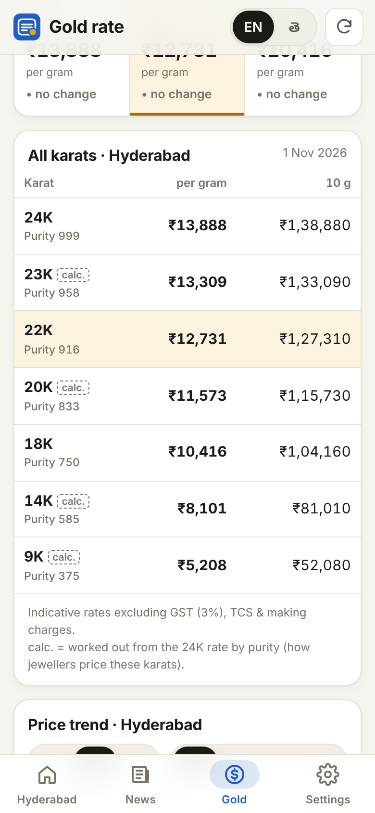

# Taaza · తాజా

**Taaza** (తాజా, *fresh*): ad-free news in English and Telugu, with your city's news and today's gold rates. Free, open source, installable on any phone.

👉 **Use it:** https://pavan-98.github.io/aggregator/

<p>
  
  
  
</p>

Google News and most news apps are full of ads and trackers. This is a fast, clean, personal reader: headlines only, linking straight to the publishers. It runs entirely on free services: no server, no accounts, no API keys, no ads, no tracking.

## Features

| Tab | What's there |
|---|---|
| **Home (your city)** | Today's gold rates for your city (24K / 22K / 18K, with change since yesterday), silver, and your city's news in English and Telugu |
| **News** | Your city plus 12 topics: Top stories, Telangana & AP, India, World, Business, Gold & markets, Tech, Cricket, Sports, Cinema, Science, Health. Swipe left/right to switch. Hide or reorder topics, and add your own topics from keywords. |
| **Gold** | **Every karat**: 24K, 23K, 22K, 20K, 18K, 14K, 9K, per gram and per 10 g. Also a 30-day, 90-day and 1-year trend, a jewellery bill calculator (making % + 3% GST), city silver, the official **IBJA** benchmark (999/995/916/750/585 and platinum), live international spot price, and a comparison across cities. |
| **Settings** | Install, my city, app language (English / తెలుగు), news language (English, Telugu or both), theme, hidden sources, backup/restore |

Cities: Hyderabad, Visakhapatnam, Vijayawada, Guntur, Warangal, Tirupati, Nellore, Rajahmundry, Kakinada, Chennai, Bengaluru, Mumbai, Delhi. [Adding a city](#add-a-city) is a few lines of config.

**Live button:** news is refreshed on a schedule (every 15 min by day). **Live** fetches the newest headlines straight from Google News on your phone, right now.

**Works offline:** the last downloaded news and rates stay readable without a connection.

## Install on your phone

Open **https://pavan-98.github.io/aggregator/**, pick your city, then:

- **Android (Chrome, Edge, Samsung Internet):** tap **Install app** in the banner, or ⋮ → *Install app*. It installs like a normal app, with long-press shortcuts to *Gold* and *News*.
- **iPhone / iPad:** open the link in **Safari** → tap **Share** → **Add to Home Screen**. iOS only allows installing from Safari.

Your settings stay on your device. *Settings → Backup* exports them to move to another phone.

## Run your own copy (fork it)

Everything runs on GitHub's free tier.

1. **Fork** this repository. It can stay public: public repos get free, unlimited GitHub Actions minutes.
2. In your fork: **Settings → Pages → Build and deployment → Source: GitHub Actions**. This step matters: with *Deploy from a branch*, GitHub publishes this README instead of the app.
3. **Actions** tab → enable workflows → **"Update news & gold, deploy to Pages" → Run workflow**.
4. Open `https://<your-username>.github.io/<repo-name>/`.

The workflow then runs automatically every 15 minutes by day (IST) and hourly at night. It also commits the day's gold rates once a day, so the trend chart keeps growing.

> **Private fork?** GitHub Pages from a private repo needs GitHub Pro/Team. Each run bills about 1 Actions minute, roughly 2,400 min/month on this schedule. On a plan with fewer included minutes, change `7,22,37,52` to `7,37` in [`.github/workflows/update.yml`](.github/workflows/update.yml) (every 30 min).

### Run locally

```bash
node scripts/build.mjs                       # Node 20+; fetches everything into _site/
python3 -m http.server 8080 -d _site         # open http://localhost:8080
node scripts/fetch-gold.mjs --backfill 365   # (re)fill a year of spot-price history
node scripts/make-icons.cjs                  # regenerate PNG app icons (needs Playwright)
```

There are no dependencies: plain Node scripts and plain browser JavaScript. There is no `npm install` and no bundler.

### Add a city

Add an entry to [`config/cities.json`](config/cities.json):

```json
{ "id": "kurnool", "name": { "en": "Kurnool", "te": "కర్నూలు" }, "region": "ap",
  "aliases": { "en": ["Kurnool"], "te": ["కర్నూలు"] }, "groww": "kurnool" }
```

That one entry gives the city:

- **News:** Google News searches for the `aliases` in both languages, plus the region's Telugu feeds (`ap` / `ts`) filtered to stories that mention the city.
- **Gold:** rates come from Groww; `groww` is the city's slug in groww.in URLs. You can add `gr` (the goodreturns.in slug) as a backup source and `short` (a short name for the tab bar).

### Change topics and feeds

Edit [`config/topics.json`](config/topics.json). A topic has:

- **Google News query per language:** `{ "top": true }`, `{ "section": "WORLD" }` or `{ "q": "search words", "when": "2d" }`.
- **Optional publisher RSS feeds.** Each feed can take `"match"` (a regex that keeps only matching stories) and `"max"` (how many items to read).

### Optional: your own CORS proxy (faster Live button)

Browsers can't read Google News directly, so the Live button and custom topics go through free public proxies by default. These can be slow or return only 10 stories. For a fast, reliable Live button:

1. Create a free Cloudflare account and open *Workers & Pages → Create → Worker*.
2. Paste in [`worker/cors-proxy.js`](worker/cors-proxy.js) and deploy. It only fetches Google News and the gold APIs.
3. Paste the worker URL into the app's *Settings → Own CORS proxy*.

The free plan allows 100,000 requests per day.

## How it works

```
GitHub Actions (every 15 min by day, hourly at night)          GitHub Pages
 ├─ scripts/fetch-news.mjs → data/news/<topic>.<en|te>.json ─┐
 ├─ scripts/fetch-gold.mjs → data/gold.json                  ├─► index.html + assets/*.js   (installable PWA)
 │                         → data/gold-history.json (committed daily)   ├─ sw.js: offline cache
 └─ actions/deploy-pages                                     ┘           ├─ Live: Google News via CORS proxy
                                                                             └─ live spot price: gold-api.com (60 s)
```

**Why this design:** GitHub Pages only hosts static files. It has no server code, no custom headers, and every file gets `Cache-Control: max-age=600`. So all data is fetched ahead of time by a GitHub Actions job (custom Actions deploys aren't subject to the 10-builds/hour limit) and published as small JSON files. The app adds a per-minute cache-buster to data requests, and a service worker handles offline use. The service worker is versioned by a hash of the app files, so phones download a new version only when the app itself changes.

Sources: [GitHub Pages limits](https://docs.github.com/en/pages/getting-started-with-github-pages/github-pages-limits), [workflow schedules](https://docs.github.com/en/actions/writing-workflows/choosing-when-your-workflow-runs/events-that-trigger-workflows#schedule), [Actions billing](https://docs.github.com/en/billing/concepts/product-billing/github-actions).

## Data sources (all free, no API keys)

### Gold & silver

| Source | Used for |
|---|---|
| **groww.in** | City retail rates (24K / 22K / 18K) for ~300 Indian cities plus 10 days of history in one request; silver per city |
| **goodreturns.in** | Backup city rates, used automatically if Groww fails, misses a city or returns a stale date |
| **ibjarates.com** | Official India Bullion & Jewellers Association benchmark: 999 / 995 / 916 / 750 / 585 gold, silver, platinum, plus ~4 months of history |
| **api.gold-api.com** | Real-time international gold and silver price (also polled live by the app) |
| **fawazahmed0/exchange-api** | Spot fallback and daily spot history |

Cities publish 24K, 22K and 18K. **23K, 20K, 14K and 9K** (the other BIS hallmark grades) are calculated as 24K × karat/24, the way jewellers' rate cards derive them, and are marked *calc.* All rates exclude GST (3%), TCS and making charges. Older chart points with no published city rate are estimated from the international price and drawn dashed.

### News

| Source | Used for |
|---|---|
| **Google News RSS**, English (`hl=en-IN`) and Telugu (`hl=te`) | The backbone of every topic and city: thousands of publishers, including Eenadu, Sakshi, Andhra Jyothy, The Hindu, TOI and NDTV |
| TV9 Telugu, NTV Telugu, V6 Velugu, 10TV, Andhra Jyothy, Asianet Telugu, Oneindia Telugu | Telugu topics, and city news filtered by city name |
| Telangana Today, Deccan Chronicle, NDTV, Vizag Vision | English topics and city news |
| rss2json.com, allorigins.win, codetabs.com | In-browser Live fetch (public CORS proxies) |

Evaluated and not used:

- **NewsAPI.org:** browser use is blocked on the free plan.
- **GNews, NewsData.io, Mediastack, Currents, TheNewsAPI, goldapi.io, metals.dev:** each needs an API key with a small quota, and a key would leak in a public site.
- **GDELT:** limited to one request every 5 seconds, with no CORS.
- **The Hindu, BBC Telugu, Sakshi and Mint direct RSS feeds:** they block automated fetchers. Their stories still arrive through Google News.

## Privacy

- **No accounts, analytics, cookies or ads.**
- **Settings** stay in your browser's local storage.
- **Pressing Live** sends your query to Google News through a CORS proxy. It goes through public proxies unless you set your own Cloudflare Worker.
- **The Gold tab** fetches the live price from gold-api.com.

## Etiquette & disclaimer

- **This is a reader, not a publisher.** It shows headlines with links to the original publishers, the way any RSS reader does.
- **The fetchers are polite.** They identify themselves honestly (with a link to the repository running them), run at most every 15 minutes, and don't try to get around sites that block them.
- **Gold rates are indicative,** gathered from public sources. Confirm with your jeweller before buying.
- **Running your own copy:** respect the source sites' terms.

## License

[MIT](LICENSE) © Pavan Kalyan Neerukonda
